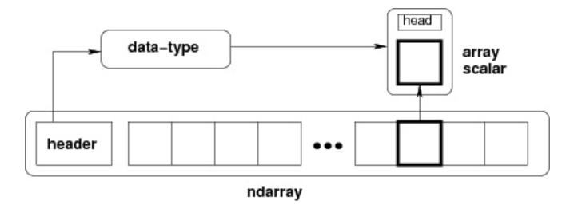
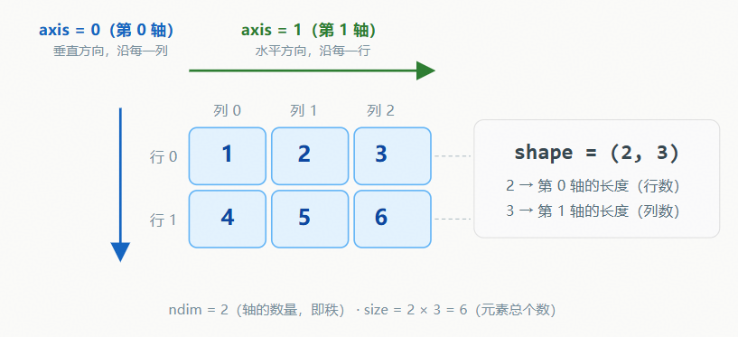
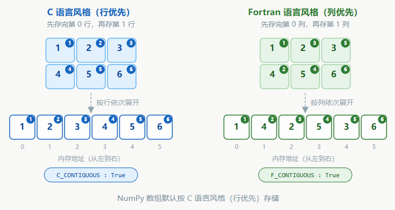

# 1、概述

## 1.1 介绍

- numpy 是 Python 中<font color="red">**科学计算的基础包**</font>。 它是一个 Python 库，提供<font color="red">**多维数组对象、各种派生对象（例如掩码数组和矩阵）以及用于对数组进行快速操作的各种方法**</font>，包括数学、逻辑、形状操作、排序、选择、I/O、离散傅里叶变换、基本线性代数、基本统计运算、随机模拟等等。

- numpy 的部分功能如下：

  - ndarray，一个具有矢量算术运算和复杂广播能力的快速且节省空间的多维数组。

  - 用于对整组数据进行快速运算的标准数学函数（无需编写循环）。

  - 用于读写磁盘数据的工具以及用于操作内存映射文件的工具。

  - 线性代数、随机数生成以及傅里叶变换功能。

  - 用于集成由 C、C++、Fortran 等语言编写的代码的 API。


## 1.2 安装

- 安装依赖：pip install numpy
- 添加清华链接：pip install numpy -i https://pypi.tuna.tsinghua.edu.cn/simple


# 二、ndarray

## 1、介绍

- NumPy 最重要的一个特点是其<font color="red">**N 维数组对象 ndarray**</font>，它是一系列同类型数据的集合，以 0 下标为开始进行集合中元素的索引。
- ndarray 对象是用于<font color="red">**存放同类型元素**</font>的多维数组。
- ndarray 中的每个元素在内存中都<font color="red">**有相同存储大小**</font>的区域。
- 跨度可以是负数，这样会使数组在内存中后向移动，切片中 **obj[::-1]** 或 **obj[:,::-1]** 就是如此。
- ndarray 内部由以下内容组成：

  - 一个指向数据（内存或内存映射文件中的一块数据）的指针。
  - 数据类型或 dtype，描述在数组中的固定大小值的格子。
  - 一个表示数组形状（shape）的元组，表示各维度大小的元组。
  - 一个跨度元组（stride），其中的整数指的是为了前进到当前维度下一个元素需要"跨过"的字节数



- 创建一个 ndarray 只需调用 NumPy 的 array 函数即可：

~~~python
numpy.array(object, dtype = None, copy = True, order = None, subok = False, ndmin = 0)
~~~

- 参数说明

| 名称   | 描述                                                      |
| ------ | --------------------------------------------------------- |
| object | 数组或嵌套的数列                                          |
| dtype  | 数组元素的数据类型，可选                                  |
| copy   | 对象是否需要复制，可选                                    |
| order  | 创建数组的样式，C为行方向，F为列方向，A为任意方向（默认） |
| subok  | 默认返回一个与基类类型一致的数组                          |
| ndmin  | 指定生成数组的最小维度                                    |

- 示例代码

~~~python
import numpy as np

a = np.array([1, 2, 3])
print(a)
# [1 2 3]

b = np.array([[1,  2],  [3,  4]])
print(b)
"""
[[1 2]
 [3 4]]
"""

c = np.array([1, 2, 3, 4, 5], ndmin =  2)
print(c)
# [[1 2 3 4 5]]

d = np.array([1,  2,  3], dtype = complex)
print(d)
# [1.+0.j 2.+0.j 3.+0.j]
~~~


## 2、核心特性

- **多维性**：支持 0 维（标量）、1 维（向量）、2 维（矩阵）及更高维数组。
- **同质性**：所有元素类型必须一致（通过 dtype 指定）。
- **高效性**：基于连续内存块存储，支持向量化运算。


### 2.1 多维性

- 实例1：0维数组

~~~python
import numpy as np

a = np.array(5)
print(a)
print(f"数组维度：{a.ndim}")


"""
5
数组维度：0
"""
~~~

- 实例2：一维数组

~~~python
import numpy as np

a = np.array([1,2,3])
print(a)
print(f"数组维度：{a.ndim}")

"""
[1 2 3]
数组维度：1
"""
~~~

- 实例3：多维数组

~~~python
import numpy as np

a = np.array([[1, 2, 3],  [4, 5, 6], [7, 8, 9]], ndmin=2)
print(a)
print(f"数组维度：{a.ndim}")


"""
[[1 2 3]
 [4 5 6]
 [7 8 9]]
数组维度：2
"""
~~~


### 2.2 同质性

-  所有元素类型必须一致（通过 dtype 指定）。
- <font color="red">**不同的数据类型会被强制转换成相同的数据类型**</font>
- 实例1

~~~python
import numpy as np

a = np.array([1, 'hello'])
print(a)

"""
['1' 'hello']
"""
~~~

- 实例2

~~~python
import numpy as np

a = np.array([1, 2.5])
print(a)


"""
[1.  2.5]
"""
~~~


### 2.3 高效性

- ndarray 内部由以下内容组成：

  - 一个指向数据（内存或内存映射文件中的一块数据）的指针。

  - 数据类型或 dtype，描述在数组中的固定大小值的格子。

  - 一个表示数组形状（shape）的元组，表示各维度大小的元组。

  - 一个跨度元组（stride），其中的整数指的是为了前进到当前维度下一个元素需要"跨过"的字节数


## 3、数据类型

### 3.1 数据类型

- numpy 支持的数据类型比 Python 内置的类型要多很多，基本上可以和 C 语言的数据类型对应上，其中部分类型对应为 Python 内置的类型

| 名称       | 描述                                                         |
| ---------- | ------------------------------------------------------------ |
| bool_      | 布尔型数据类型（True 或者 False）                            |
| int_       | 默认的整数类型（类似于 C 语言中的 long，int32 或 int64）     |
| intc       | 与 C 的 int 类型一样，一般是 int32 或 int 64                 |
| intp       | 用于索引的整数类型（类似于 C 的 ssize_t，一般情况下仍然是 int32 或 int64） |
| int8       | 字节（-128 to 127）                                          |
| int16      | 整数（-32768 to 32767）                                      |
| int32      | 整数（-2147483648 to 2147483647）                            |
| int64      | 整数（-9223372036854775808 to 9223372036854775807）          |
| uint8      | 无符号整数（0 to 255）                                       |
| uint16     | 无符号整数（0 to 65535）                                     |
| uint32     | 无符号整数（0 to 4294967295）                                |
| uint64     | 无符号整数（0 to 18446744073709551615）                      |
| float_     | float64 类型的简写                                           |
| float16    | 半精度浮点数，包括：1 个符号位，5 个指数位，10 个尾数位      |
| float32    | 单精度浮点数，包括：1 个符号位，8 个指数位，23 个尾数位      |
| float64    | 双精度浮点数，包括：1 个符号位，11 个指数位，52 个尾数位     |
| complex_   | complex128 类型的简写，即 128 位复数                         |
| complex64  | 复数，表示双 32 位浮点数（实数部分和虚数部分）               |
| complex128 | 复数，表示双 64 位浮点数（实数部分和虚数部分）               |

- numpy 的数值类型实际上是 dtype 对象的实例，并对应唯一的字符，包括 np.bool_，np.int32，np.float32，等等


### 3.2 数据类型对象 (dtype)

- 数据类型对象（numpy.dtype 类的实例）用来描述与数组对应的内存区域是如何使用，它描述了数据的以下几个方面：：
  - 数据的类型（整数，浮点数或者 Python 对象）
  - 数据的大小（例如， 整数使用多少个字节存储）
  - 数据的字节顺序（小端法或大端法）
  - 在结构化类型的情况下，字段的名称、每个字段的数据类型和每个字段所取的内存块的部分
  - 如果数据类型是子数组，那么它的形状和数据类型是什么。

- 字节顺序是通过对数据类型预先设定 < 或 > 来决定的。 < 意味着小端法(最小值存储在最小的地址，即低位组放在最前面)。> 意味着大端法(最重要的字节存储在最小的地址，即高位组放在最前面)。

- dtype 对象是使用以下语法构造的：
  - object - 要转换为的数据类型对象
  - align - 如果为 true，填充字段使其类似 C 的结构体。
  - copy - 复制 dtype 对象 ，如果为 false，则是对内置数据类型对象的引用

```
numpy.dtype(object, align, copy)
```

- 示例

~~~python
import numpy as np

# 1、使用标量类型
dt = np.dtype(np.int_)
print(dt)
# int64

# 2、int8, int16, int32, int64 四种数据类型可以使用字符串 'i1', 'i2','i4','i8' 代替
dt = np.dtype('i4')
print(dt)
# int32

# 3、字节顺序标注
dt = np.dtype('<i4')
print(dt)
# int32

# 4、首先创建结构化数据类型
dt = np.dtype([('age',np.int8)])
print(dt)
# [('age', 'i1')]

# 5、将数据类型应用于 ndarray 对象
dt = np.dtype([('age',np.int8)])
a = np.array([(10,),(20,),(30,)], dtype = dt)
print(a)
# [(10,) (20,) (30,)]

# 6、类型字段名可以用于存取实际的 age 列
dt = np.dtype([('age',np.int8)])
a = np.array([(10,),(20,),(30,)], dtype = dt)
print(a['age'])
# [10 20 30]

# 7、定义一个结构化数据类型 student，包含字符串字段 name，整数字段 age，及浮点字段 marks
"""
• name: 类型为 'S20'，表示长度最多为 20 的 字节字符串（Byte string）。
• age: 类型为 'i1'，表示 1 字节（8位）的有符号整数（等同于 np.int8）。
• marks: 类型为 'f4'，表示 4 字节（32位）的单精度浮点数（等同于 np.float32）。
"""
student = np.dtype([('name','S20'), ('age', 'i1'), ('marks', 'f4')])
print(student)
# [('name', 'S20'), ('age', 'i1'), ('marks', '<f4')]

# 8、并将这个 dtype 应用到 ndarray 对象
student = np.dtype([('name','S20'), ('age', 'i1'), ('marks', 'f4')])
a = np.array([('abc', 21, 50),('xyz', 18, 75)], dtype = student)
print(a)
# [(b'abc', 21, 50.) (b'xyz', 18, 75.)], 名字前面的 b（如 b'abc'）表示这是一个字节串（bytes），这是因为前面指定了 'S20' 类型
~~~

- 每个内建类型都有一个唯一定义它的字符代码，如下：

| 字符 | 对应类型              |
| ---- | --------------------- |
| b    | 布尔型                |
| i    | (有符号) 整型         |
| u    | 无符号整型 integer    |
| f    | 浮点型                |
| c    | 复数浮点型            |
| m    | timedelta（时间间隔） |
| M    | datetime（日期时间）  |
| O    | (Python) 对象         |
| S, a | (byte-)字符串         |
| U    | Unicode               |
| V    | 原始数据 (void)       |


## 4、数组类型

### 4.1 数组维度

- NumPy 数组的维数称为秩（rank），<font color="red">**秩就是轴的数量，即数组的维度**</font>

- 一维数组的秩为 1，二维数组的秩为 2，以此类推。

- 在 NumPy 中，数组的每一个维度称为一个轴（axis），也就是维度（dimensions）。
  - 比如说，二维数组可以看作是"一维数组组成的一维数组"：外层数组的每个元素本身又是一个一维数组。
  - 其中第 0 轴相当于是最外层数组的方向，第 1 轴是内层数组的方向，以此类推。

- 轴的数量——秩，就是数组的维数。

- 很多 NumPy 函数都支持 axis 参数。

- 对二维数组而言，axis=0 表示沿着第 0 轴进行操作，即对每一列进行操作；axis=1 表示沿着第 1 轴进行操作，即对每一行进行操作。

- 下面以一个 shape 为 (2, 3) 的二维数组为例，直观展示两个轴的方向以及各属性的含义：



- 注意：<font color="red">**axis 表示的是"沿哪个方向压缩"，而不是"第几行/第几列"：沿 axis=0 求和是把多行压成一行，因此结果是每一列的和**</font>

~~~python
import numpy as np

a = np.array([[1, 2, 3], [4, 5, 6]])

# 沿第 0 轴求和：跨行方向压缩，对每一列求和
print(a.sum(axis=0))
# [5 7 9]

# 沿第 1 轴求和：跨列方向压缩，对每一行求和
print(a.sum(axis=1))
# [ 6 15]
~~~


### 4.2 对象属性

| 属性名称     | 通俗解释                                     | 补充说明                                                | 使用示例     |
| ------------ | -------------------------------------------- | ------------------------------------------------------- | ------------ |
| **shape**    | 数组的形状：行数和列数（或更高维度的尺寸）   | 表示数组在每个轴上的大小；二维数组（矩阵）即行数和列数  | arr.shape    |
| **ndim**     | 维度数量：数组是几维的（1 维、2 维、3 维等） | 数组的秩（rank），即维度数量或轴的数量                  | arr.ndim     |
| **size**     | 总元素个数：数组中所有元素的总数             | 等于 shape 中各轴大小的乘积                             | arr.size     |
| **dtype**    | 元素类型：数组中元素的类型（整数、浮点数等） | 数组中元素的数据类型                                    | arr.dtype    |
| **T**        | 转置：行变列，列变行                         | —                                                       | arr.T        |
| **itemsize** | 单个元素占用的内存字节数                     | 以字节为单位                                            | arr.itemsize |
| **nbytes**   | 数组总内存占用量                             | size * itemsize                                         | arr.nbytes   |
| **flags**    | 内存存储方式：是否连续存储（高级优化）       | 内存布局信息，如是否为 C / Fortran 连续存储、是否只读等 | arr.flags    |
| **real**     | 数组中每个元素的实部                         | 元素类型为复数时生效                                    | arr.real     |
| **imag**     | 数组中每个元素的虚部                         | 元素类型为复数时生效                                    | arr.imag     |
| **data**     | 实际存储数组元素的缓冲区                     | 一般通过索引访问元素，不直接使用该属性                  | arr.data     |

- <font color="red">**ndarray.ndim**</font>： 用于获取数组的维度数量（即数组的轴数），也就是秩

~~~python
import numpy as np

a = np.arange(24)
print(a.ndim)             # a 现在只有一个维度

# 通过 reshape 调整其大小，变成 2 页 4 行 3 列
b = a.reshape(2, 4, 3)    # b 现在拥有三个维度
print(b.ndim)
~~~

- <font color="red">**ndarray.shape**</font>

  - <font color="red">**ndarray.shape 表示数组的维度**</font>，返回一个元组，这个元组的长度就是维度的数目，即 ndim 属性（秩）。
  - 比如，一个二维数组的 shape 表示其"行数"和"列数"。
  - shape 元组的顺序与轴的顺序一致：第 0 个元素是第 0 轴的大小（行数），第 1 个元素是第 1 轴的大小（列数）

  ~~~python
  import numpy as np
  
  a = np.array([[1, 2, 3], [4, 5, 6]])
  print(a.shape)
  
  """
  (2, 3)
  """
  ~~~

  - ndarray.shape 也可以用于调整数组大小

  ~~~python
  import numpy as np
  
  a = np.array([[1, 2, 3], [4, 5, 6]])
  a.shape = (3, 2)
  print(a)
  
  """
  [[1 2]
   [3 4]
   [5 6]]
  """
  ~~~
  - NumPy也提供了 reshape 函数来调整数组大小

  ~~~python
  import numpy as np
  
  a = np.array([[1, 2, 3], [4, 5, 6]])
  b = a.reshape(3, 2)
  print(b)
  
  """
  [[1 2]
   [3 4]
   [5 6]]
  """
  ~~~

  - 注意：两种方式的区别：<font color="red">**直接给 a.shape 赋值会原地修改数组 a 本身；而 a.reshape(3, 2) 返回一个新的数组对象（通常与 a 共享同一份数据），a 本身保持不变**</font>

- <font color="red">**ndarray.size**</font>：返回数组中元素的总个数，等于 shape 中各个轴上大小的乘积

~~~python
import numpy as np

a = np.array([[1, 2, 3], [4, 5, 6]])
print(a.size)

"""
6
"""
~~~

- <font color="red">**ndarray.dtype**</font>：返回数组中元素的数据类型。
  - dtype 对象包含类型名和元素位宽等信息，例如 int64 表示 64 位整数、float32 表示 32 位浮点数

~~~python
import numpy as np

# 整数列表默认创建 int64 数组（Windows 上默认为 int32）
a = np.array([1, 2, 3])
print(a.dtype)

# 创建时可以用 dtype 参数显式指定数据类型
b = np.array([1, 2, 3], dtype=np.float32)
print(b.dtype)

"""
int64
float32
"""
~~~

- <font color="red">**ndarray.real 和 ndarray.imag 分别返回数组中每个元素的实部和虚部**</font>，主要在元素类型为复数（complex）时使用

~~~python
import numpy as np

# 创建一个复数数组，默认类型为 complex128
a = np.array([1+2j, 3+4j, 5+6j])
print(a.real)   # 每个元素的实部
print(a.imag)   # 每个元素的虚部

"""
[1. 3. 5.]
[2. 4. 6.]
"""
~~~

- <font color="red">**ndarray.itemsize**</font>：以字节的形式返回数组中每一个元素的大小。

  - 例如，一个元素类型为 float64 的数组，itemsize 属性值为 8（float64 占用 64 位，每 8 位为 1 个字节，64 ÷ 8 = 8 个字节）。

  - 又如，一个元素类型为 int32 的数组，itemsize 属性值为 4（32 ÷ 8）。

  - size 与 itemsize 的乘积就是数组数据占用的总字节数，也就是属性 ndarray.nbytes 的值。

~~~python
import numpy as np

# 数组的 dtype 为 int8，每个元素占 1 个字节
x = np.array([1, 2, 3, 4, 5], dtype=np.int8)
print(x.itemsize)
print(x.nbytes)

# 数组的 dtype 为 float64，每个元素占 8 个字节
y = np.array([1, 2, 3, 4, 5], dtype=np.float64)
print(y.itemsize)
print(y.nbytes)

"""
1
5
8
40
"""
~~~

- <font color="red">**ndarray.flags**</font>：返回 ndarray 对象的内存信息，包含以下属性

  - C_CONTIGUOUS 与 F_CONTIGUOUS 描述的是同一份数据在内存中的排列顺序，同一个二维数组有两种典型的存法：

  

| 属性                | 描述                                                         |
| ------------------- | ------------------------------------------------------------ |
| C_CONTIGUOUS (C)    | 数据是在一个单一的、C 语言风格的连续内存区域中               |
| F_CONTIGUOUS (F)    | 数据是在一个单一的、Fortran 语言风格的连续内存区域中         |
| OWNDATA (O)         | 数组拥有它所使用的内存，而不是从其它对象借用                 |
| WRITEABLE (W)       | 数据区域可以被写入，将该值设置为 False，则数据为只读         |
| ALIGNED (A)         | 数据和所有元素都适当地对齐到硬件上                           |
| WRITEBACKIFCOPY (X) | 这个数组是其它数组的一个副本，当这个数组被释放时，其内容将被写回原数组 |

~~~python
import numpy as np

x = np.array([1, 2, 3, 4, 5])
print(x.flags)

"""
  C_CONTIGUOUS : True
  F_CONTIGUOUS : True
  OWNDATA : True
  WRITEABLE : True
  ALIGNED : True
  WRITEBACKIFCOPY : False
"""
~~~

- <font color="red">**ndarray.T**</font>：表示转置

~~~python
import numpy as np

a = np.array([[1, 2, 3], [4, 5,6]])
print(f"a的转置：{a.T}")

"""
a的转置：[[1 4]
 [2 5]
 [3 6]]
"""
~~~


## 5、创建方式

### 5.1 创建方式汇总

- ndarray创建：
  - 基础构造：适用于手动构建小规模数组或复制已有数据。对应方法：array()、copy()
  - 预定义形状填充：用于快速初始化固定形状的数组（如全0占位、全1初始化）。对应方法：zeros()、ones()、empty()、full()
  - 基于数值范围生成：生成数值序列，常用于模拟时间序列、坐标网格。对应方法：arange()、linspace()、logspace()
  - 特殊矩阵生成：数学运算专用（如线性代数中的单位矩阵）。对应方法：eye()、diag()
  - 随机数组生成：模拟试验数据、初始化神经网络权重等场景。对应方法：random.rand()、random.randn()、random.randint()
  - 高级构造方法：处理非结构化数据（如文件、字符串）或通过函数生成复杂数组。对应方法：array()、loadtxt()、fromfunction()。


### 5.2 基础构造

- 使用基础数组或者copy创建

~~~python
import numpy as np

# 基础创建
arr = np.array([1,2,3], dtype=np.float64) # 使用dtype参数可以指定强制转换成某个类型
print(arr)

# 复制
arr1 = np.copy(arr) # 从arr拷贝出一个数组arr1,不是同一个数组了（深拷贝，拷贝后修改arr不会影响arr1的值）
print(arr1)

"""
[1. 2. 3.]
[1. 2. 3.]
"""
~~~


### 5.3 预定义形状填充

#### 5.3.1 numpy.empty

- numpy.empty 方法用来创建一个指定形状（shape）、数据类型（dtype）且未初始化的数组

~~~python
numpy.empty(shape, dtype = float, order = 'C')
~~~

- 参数说明

| 参数  | 描述                                                         |
| ----- | ------------------------------------------------------------ |
| shape | 数组形状                                                     |
| dtype | 数据类型，可选                                               |
| order | 有"C"和"F"两个选项,分别代表，行优先和列优先，在计算机内存中的存储元素的顺序。 |

- 代码

~~~python
import numpy as np

a = np.empty(shape=(2, 3), dtype=int, order='C')
print(a)

"""
[[9218868437227405311   -4503599627370497 4611686018427387904]
 [4372995238176751616    4503599627370496                   1]]
"""
~~~


#### 5.3.2 numpy.zeros

- 创建指定大小的数组，数组元素以 0 来填充：

~~~python
numpy.zeros(shape, dtype = float, order = 'C')
~~~

- 参数说明：

| 参数  | 描述                                                |
| ----- | --------------------------------------------------- |
| shape | 数组形状                                            |
| dtype | 数据类型，可选                                      |
| order | 'C' 用于 C 的行数组，或者 'F' 用于 FORTRAN 的列数组 |

- 代码

~~~python
import numpy as np

# 默认为浮点数
x = np.zeros(5)
print(x)
"""
[0. 0. 0. 0. 0.]
"""

# 设置类型为整数
y = np.zeros((5,), dtype=int)
print(y)
"""
[0 0 0 0 0]
"""

# 自定义类型
z = np.zeros((3, 2), dtype=[('x', 'i4'), ('y', 'i4')])
print(z)
"""
对象数组，每个元素都是(0, 0),两列分别为x列和y列
[[(0, 0) (0, 0)]
 [(0, 0) (0, 0)]
 [(0, 0) (0, 0)]]
"""
~~~


#### 5.3.3 numpy.ones

- 创建指定形状的数组，数组元素以 1 来填充

~~~python
numpy.ones(shape, dtype = None, order = 'C')
~~~

- 参数类型

| 参数  | 描述                                                |
| ----- | --------------------------------------------------- |
| shape | 数组形状                                            |
| dtype | 数据类型，可选                                      |
| order | 'C' 用于 C 的行数组，或者 'F' 用于 FORTRAN 的列数组 |

- 代码

~~~python
import numpy as np

# 默认为浮点数
x = np.ones(5)
print(x)
"""
[1. 1. 1. 1. 1.]
"""

# 自定义类型
x = np.ones([2, 2], dtype=int)
print(x)
"""
[[1 1]
 [1 1]]
"""
~~~


#### 5.3.4 numpy.zeros_like

- numpy.zeros_like 用于创建一个与给定数组具有相同形状的数组，数组元素以 0 来填充。
- numpy.zeros 和 numpy.zeros_like 都是用于创建一个指定形状的数组，其中所有元素都是 0。
- 它们之间的区别在于：numpy.zeros 可以直接指定要创建的数组的形状，而 numpy.zeros_like 则是创建一个与给定数组具有相同形状的数组。

```python
numpy.zeros_like(a, dtype=None, order='K', subok=True, shape=None)
```

- 参数说明：

| 参数  | 描述                                                         |
| ----- | ------------------------------------------------------------ |
| a     | 给定要创建相同形状的数组                                     |
| dtype | 创建的数组的数据类型                                         |
| order | 数组在内存中的存储顺序，可选值为 'C'（按行优先）或 'F'（按列优先），默认为 'K'（保留输入数组的存储顺序） |
| subok | 是否允许返回子类，如果为 True，则返回一个子类对象，否则返回一个与 a 数组具有相同数据类型和存储顺序的数组 |
| shape | 创建的数组的形状，如果不指定，则默认为 a 数组的形状。        |

- 代码

~~~python
import numpy as np

# 创建一个 3x3 的二维数组
arr = np.array([[1, 2, 3], [4, 5, 6], [7, 8, 9]])

# 创建一个与 arr 形状相同的，所有元素都为 0 的数组
zeros_arr = np.zeros_like(arr, dtype=float, subok=True)
print(zeros_arr)
"""
[[0. 0. 0.]
 [0. 0. 0.]
 [0. 0. 0.]]
"""

# 演示subok
# 1. 创建一个 NumPy 矩阵子类 (Matrix Subclass)
mat = np.matrix([[1, 2], [3, 4]])
print(type(mat))  # 输出: <class 'numpy.matrix'>

# 2. 当 subok=True (默认值)
res_true = np.zeros_like(mat, subok=True)
print(type(res_true))
# 输出: <class 'numpy.matrix'>  <-- 成功继承了子类属性！

# 3. 当 subok=False
res_false = np.zeros_like(mat, subok=False)
print(type(res_false))
# 输出: <class 'numpy.ndarray'>   <-- 被打回原形，变成了普通数组！
~~~


#### 5.3.5 numpy.ones_like

- numpy.ones_like 用于创建一个与给定数组具有相同形状的数组，数组元素以 1 来填充。

- numpy.ones 和 numpy.ones_like 都是用于创建一个指定形状的数组，其中所有元素都是 1。

- 它们之间的区别在于：numpy.ones 可以直接指定要创建的数组的形状，而 numpy.ones_like 则是创建一个与给定数组具有相同形状的数组。

```python
numpy.ones_like(a, dtype=None, order='K', subok=True, shape=None)
```

- 参数说明：

| 参数  | 描述                                                         |
| ----- | ------------------------------------------------------------ |
| a     | 给定要创建相同形状的数组                                     |
| dtype | 创建的数组的数据类型                                         |
| order | 数组在内存中的存储顺序，可选值为 'C'（按行优先）或 'F'（按列优先），默认为 'K'（保留输入数组的存储顺序） |
| subok | 是否允许返回子类，如果为 True，则返回一个子类对象，否则返回一个与 a 数组具有相同数据类型和存储顺序的数组 |
| shape | 创建的数组的形状，如果不指定，则默认为 a 数组的形状。        |

- 代码

~~~python
import numpy as np
 
# 创建一个 3x3 的二维数组
arr = np.array([[1, 2, 3], [4, 5, 6], [7, 8, 9]])
 
# 创建一个与 arr 形状相同的，所有元素都为 1 的数组
ones_arr = np.ones_like(arr)
print(ones_arr)

"""
[[1 1 1]
 [1 1 1]
 [1 1 1]]
"""
~~~


### 5.4 从已有的数组创建数组

#### 5.3.1 numpy.asarray

- numpy.asarray 类似 numpy.array，但 numpy.asarray 参数只有三个，比 numpy.array 少两个

~~~python
numpy.asarray(a, dtype = None, order = None)
~~~

- 参数说明

| 参数  | 描述                                                         |
| ----- | ------------------------------------------------------------ |
| a     | 任意形式的输入参数，可以是，列表, 列表的元组, 元组, 元组的元组, 元组的列表，多维数组 |
| dtype | 数据类型，可选                                               |
| order | 可选，有"C"和"F"两个选项,分别代表，行优先和列优先，在计算机内存中的存储元素的顺序。 |

- 代码示例

~~~python
import numpy as np

# 一维数组
x = [1, 2, 3]
a = np.asarray(x)
print(a)
"""
[1 2 3]
"""

# 元组
x = (1,2,3)
a = np.asarray(x)
print(a)
"""
[1 2 3]
"""

# 多维数组
x = [(1,2,3),(4,5,6)]
a = np.asarray(x)
print(a)
"""
[[1 2 3]
 [4 5 6]]
"""

# 设置了 dtype 参数
x = [1,2,3]
a = np.asarray(x, dtype=float)
print(a)
"""
[1 2 3]
"""
~~~


#### 5.3.2 numpy.frombuffer

- numpy.frombuffer 用于实现动态数组。

- numpy.frombuffer 接受 buffer 输入参数，<font color="red">**以流的形式读入转化成 ndarray 对象**</font>

~~~python
numpy.frombuffer(buffer, dtype = float, count = -1, offset = 0)
~~~

- 注意：buffer 是字符串的时候，Python3 默认 str 是 Unicode 类型，<font color="red">**所以要转成 bytestring 在原 str 前加上 b**</font>

- 参数说明

| 参数   | 描述                                     |
| ------ | ---------------------------------------- |
| buffer | 可以是任意对象，会以流的形式读入。       |
| dtype  | 返回数组的数据类型，可选                 |
| count  | 读取的数据数量，默认为-1，读取所有数据。 |
| offset | 读取的起始位置，默认为0。                |

- 代码

~~~python
import numpy as np

s1 = b'Hello World'
a = np.frombuffer(s1, count=7, dtype='S1')
print(a)

"""
[b'H' b'e' b'l' b'l' b'o' b' ' b'W']
"""
~~~


#### 5.3.3 numpy.fromiter

- numpy.fromiter 方法从可迭代对象中建立 ndarray 对象，返回一维数组

~~~python
numpy.fromiter(iterable, dtype, count=-1)
~~~

- 参数说明

| 参数     | 描述                                   |
| -------- | -------------------------------------- |
| iterable | 可迭代对象                             |
| dtype    | 返回数组的数据类型                     |
| count    | 读取的数据数量，默认为-1，读取所有数据 |

- 代码

~~~python
import numpy as np

# 使用 range 函数创建列表对象
list = range(5)
it = iter(list)

# 使用迭代器创建 ndarray
x = np.fromiter(it, dtype=float)
print(x)

"""
[0. 1. 2. 3. 4.]
"""
~~~


### 5.5 从数值范围创建数组

#### 5.5.1 numpy.arange

- numpy 包中的使用 arange 函数创建数值范围并返回 ndarray 对象，函数格式如下

~~~python
numpy.arange(start, stop, step, dtype)
~~~

- 根据 start 与 stop 指定的范围以及 step 设定的步长，生成一个 ndarray

| 参数  | 描述                                                         |
| ----- | ------------------------------------------------------------ |
| start | 起始值，默认为0                                              |
| stop  | 终止值（不包含）                                             |
| step  | 步长，默认为1                                                |
| dtype | 返回ndarray的数据类型，如果没有提供，则会使用输入数据的类型。 |

- 代码

~~~python
import numpy as np

x = np.arange(5, dtype=float)
print(x)
"""
[0. 1. 2. 3. 4.]
"""

x = np.arange(0, 5, dtype=float, step=2)
print(x)
"""
[0. 2. 4.]
"""
~~~


#### 5.5.2 numpy.linspace

- numpy.linspace 函数用于创建一个一维数组，数组是一个等差数列构成的，格式如下

~~~python
np.linspace(start, stop, num=50, endpoint=True, retstep=False, dtype=None)
~~~

- 参数说明

| 参数     | 描述                                                       |
| -------- | ---------------------------------------------------------- |
| start    | 序列的起始值                                               |
| stop     | 序列的终止值，如果endpoint为true，该值包含于数列中         |
| num      | 要生成的等步长的样本数量，默认为50                         |
| endpoint | 该值为 true 时，数列中包含stop值，反之不包含，默认是True。 |
| retstep  | 如果为 True 时，生成的数组中会显示间距，反之不显示。       |
| dtype    | ndarray 的数据类型                                         |

- 代码

~~~python
import numpy as np

# 设置起始点为 1 ，终止点为 10，数列个数为 10
a = np.linspace(1,10,10)
print(a)
"""
[ 1.  2.  3.  4.  5.  6.  7.  8.  9. 10.]
"""

# 设置元素全部是1的等差数列
a = np.linspace(1,1,10)
print(a)
"""
[1. 1. 1. 1. 1. 1. 1. 1. 1. 1.]
"""

# 将 endpoint 设为 false，不包含终止值
a = np.linspace(10, 20,  5, endpoint=False)
print(a)
"""
[10. 12. 14. 16. 18.]
"""

# 设置间距
a = np.linspace(10, 20,  5, endpoint=False, retstep=True)
print(a)
"""
(array([10., 12., 14., 16., 18.]), np.float64(2.0))
"""
~~~


#### 5.5.3 numpy.logspace

- numpy.logspace 函数用于创建一个于等比数列。格式如下

~~~python
np.logspace(start, stop, num=50, endpoint=True, base=10.0, dtype=None)
~~~

- base 参数意思是取对数的时候 log 的下标

| 参数     | 描述                                                         |
| -------- | ------------------------------------------------------------ |
| start    | 序列的起始值为：base ** start                                |
| stop     | 序列的终止值为：base ** stop。如果endpoint为true，该值包含于数列中 |
| num      | 要生成的等步长的样本数量，默认为50                           |
| endpoint | 该值为 true 时，数列中中包含stop值，反之不包含，默认是True。 |
| base     | 对数 log 的底数。                                            |
| dtype    | ndarray 的数据类型                                           |

- 代码

~~~python
import numpy as np


# 默认底数是 10
a = np.logspace(1.0, 2.0, num=10)
print(a)
"""
[ 10.          12.91549665  16.68100537  21.5443469   27.82559402
  35.93813664  46.41588834  59.94842503  77.42636827 100.        ]
"""

# 将对数的底数设置为 2
a = np.logspace(0,9,10,base=2)
print(a)
"""
[  1.   2.   4.   8.  16.  32.  64. 128. 256. 512.]
"""
~~~


## 6、切片和索引

