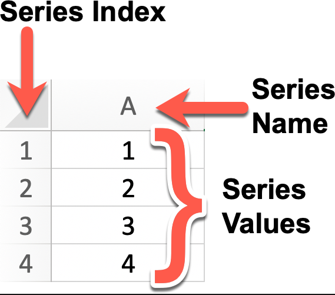
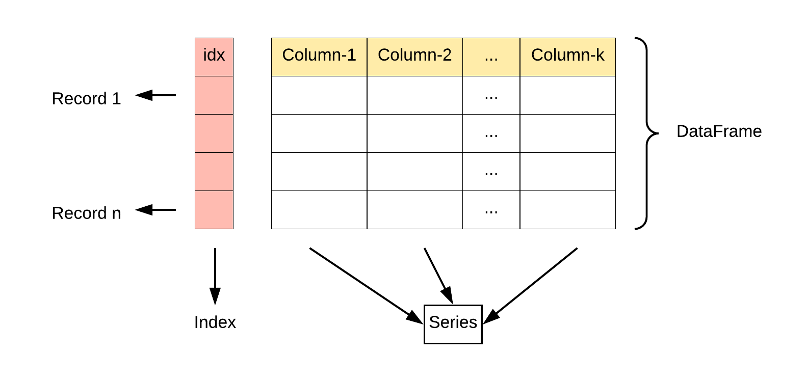
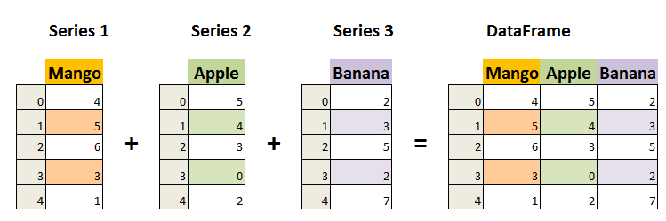

# 一、介绍

## 1、简介

- Pandas 是一个开源的<font color="red">**数据分析和数据处理库**</font>，它是基于 Python 编程语言的

- Pandas 提供了易于使用的数据结构和数据分析工具，<font color="red">**特别适用于处理结构化数据**</font>，如表格型数据（类似于Excel表格）
- Pandas 是 Python 数据分析工具链中最核心的库，充当数据读取、清洗、分析、统计、输出的高效工具

- Pandas 是<font color="red">**数据科学和分析领域**</font>中常用的工具之一，它使得用户能够轻松地从各种数据源中导入数据，并对数据进行高效的操作和分析。

- Pandas 主要引入了两种新的数据结构：<font color="red">**Series**</font> 和 <font color="red">**DataFrame**</font>


### 1.1 Series

#### 1.1.1 是什么

- Series 是 Pandas 中的一个核心数据结构，类似于一个一维的数组，<font color="red">**具有数据和索引**</font>。

- Series 可以存储任何数据类型（整数、浮点数、字符串等），并通过标签（索引）来访问元素。

- Series 的数据结构是非常有用的，因为它可以处理各种数据类型，同时保持了高效的数据操作能力，比如可以通过标签来快速访问和操作数据。


#### 1.1.2 Series特点

- <font color="red">**Series 是 Pandas 中的一种基本数据结构，类似于一维数组或列表，但具有标签（索引）**</font>，使得数据在处理和分析时更具灵活性
  - <font color="red">**一维数组**</font>：Series 中的每个元素都有一个对应的索引值。
  - <font color="red">**索引**</font>： 每个数据元素都可以通过标签（索引）来访问，默认情况下索引是从 0 开始的整数，但是也可以自定义索引。

  - <font color="red">**数据类型**</font>： Series 可以容纳不同数据类型的元素，包括整数、浮点数、字符串、Python 对象等。

  - <font color="red">**大小不变性**</font>：Series 的大小在创建后是不变的，但可以通过某些操作（如 append 或 delete）来改变。

  - <font color="red">**操作**</font>：Series 支持各种操作，如数学运算、统计分析、字符串处理等。

  - <font color="red">**缺失数据**</font>：Series 可以包含缺失数据，Pandas 使用NaN（Not a Number）来表示缺失或无值。

  - <font color="red">**自动对齐**</font>：当对多个 Series 进行运算时，Pandas 会自动根据索引对齐数据，这使得数据处理更加高效。



- 可以使用 Pandas 库来创建一个 Series 对象，并且可以为其指定索引（Index）、名称（Name）以及值（Values）：

~~~python
import pandas as pd

# 创建一个Series对象，指定名称为'A'，值分别为1, 2, 3, 4
# 默认索引为0, 1, 2, 3
series = pd.Series([1, 2, 3, 4], name='A')

# 显示Series对象
print(series)

# 如果你想要显式地设置索引，可以这样做：
custom_index = [1, 2, 3, 4]  # 自定义索引
series_with_index = pd.Series([1, 2, 3, 4], index=custom_index, name='A')

# 显示带有自定义索引的Series对象
print(series_with_index)


"""
0    1
1    2
2    3
3    4
Name: A, dtype: int64
1    1
2    2
3    3
4    4
Name: A, dtype: int64
"""
~~~


#### 1.1.3 Series的创建

- 可以使用 pd.Series() 构造函数创建一个 Series 对象，传递一个数据数组（可以是列表、NumPy 数组等）和一个可选的索引数组

~~~python
pandas.Series(data=None, index=None, dtype=None, name=None, copy=False, fastpath=False)
~~~

- 参数说明：

  - data：Series 的数据部分，可以是列表、数组、字典、标量值等。如果不提供此参数，则创建一个空的 Series。

  - index：Series 的索引部分，用于对数据进行标记。可以是列表、数组、索引对象等。如果不提供此参数，则创建一个默认的整数索引。

  - dtype：指定 Series 的数据类型。可以是 NumPy 的数据类型，例如 np.int64、np.float64 等。如果不提供此参数，则根据数据自动推断数据类型。

  - name：Series 的名称，用于标识 Series 对象。如果提供了此参数，则创建的 Series 对象将具有指定的名称。

  - copy：是否复制数据。默认为 False，表示不复制数据。如果设置为 True，则复制输入的数据。

  - fastpath：是否启用快速路径。默认为 False。启用快速路径可能会在某些情况下提高性能。

- 示例

  - 示例1：创建一个简单的Series实例
    - 输出左侧为索引，右侧为数据，可以看到<font color="red">**如果没有自动设置，索引是从0开始的**</font>
    - dtype为Series自动推断的数据类型

  ~~~python
  import pandas as pd
  
  # 创建一个简单的 Series 实例
  a = [1, 2, 3]
  series = pd.Series(a)
  
  # 打印
  print(series)
  
  
  """
  0    1
  1    2
  2    3
  dtype: int64
  """
  ~~~

  - 示例2：指定索引值创建Series实例

  ~~~python
  import pandas as pd
  
  # 创建一个简单的 Series 实例
  a = [1, 2, 3]
  series = pd.Series(data=a, index=['x', 'y', 'z'])
  
  # 打印
  print(series)
  
  """
  x    1
  y    2
  z    3
  dtype: int64
  """
  ~~~

  - 示例3：根据索引值获取数据

  ~~~python
  import pandas as pd
  
  # 创建一个简单的 Series 实例
  a = [1, 2, 3]
  b = [4, 5, 6]
  series1 = pd.Series(data=a)
  series2 = pd.Series(data=b, index=['x', 'y', 'z'])
  
  # 根据索引获取数据
  print(series1[1])
  print(series2['y'])
  
  """
  2
  5
  """
  ~~~

  - 示例4：使用 key/value 对象，类似字典来创建 Series
    - <font color="red">**对象的key即为索引，value即为数据**</font>

  ~~~python
  import pandas as pd
  
  # 创建一个简单的 Series 实例
  sites = {'x': "Google", 'y': "Runoob", 'z': "Wiki"}
  series = pd.Series(data=sites)
  
  # 根据索引获取数据
  print(series)
  print(series['y'])
  
  
  """
  x    Google
  y    Runoob
  z      Wiki
  dtype: str
  Runoob
  """
  ~~~

  - 示例5：只需要字典中的一部分数据，只需要指定需要数据的索引即可

  ~~~python
  import pandas as pd
  
  # 创建一个简单的 Series 实例
  sites = {'x': "Google", 'y': "Runoob", 'z': "Wiki"}
  series = pd.Series(data=sites, index=['x', 'z'])
  
  # 根据索引获取数据
  print(series)
  print(series['z'])
  
  """
  x    Google
  z      Wiki
  dtype: str
  Wiki
  """
  ~~~

  - 示例6：设置Series名称参数

  ~~~python
  import pandas as pd
  
  # 创建一个简单的 Series 实例
  sites = {'x': "Google", 'y': "Runoob", 'z': "Wiki"}
  series = pd.Series(sites, index=['x', 'z'], name='lzy')
  
  # 根据索引获取数据
  print(series)
  print(series.name)
  print(series['z'])
  
  """
  x    Google
  z      Wiki
  Name: lzy, dtype: str
  lzy
  Wiki
  """
  ~~~


#### 1.1.4 Series方法

| **方法名称**               | **功能描述**                                           |
| -------------------------- | ------------------------------------------------------ |
| index                      | 获取 Series 的索引                                     |
| values                     | 获取 Series 的数据部分（返回 NumPy 数组）              |
| head(n)                    | 返回 Series 的前 n 行（默认为 5）                      |
| tail(n)                    | 返回 Series 的后 n 行（默认为 5）                      |
| dtype                      | 返回 Series 中数据的类型                               |
| shape                      | 返回 Series 的形状（行数）                             |
| describe()                 | 返回 Series 的统计描述（如均值、标准差、最小值等）     |
| isnull()                   | 返回一个布尔 Series，表示每个元素是否为 NaN            |
| notnull()                  | 返回一个布尔 Series，表示每个元素是否不是 NaN          |
| unique()                   | 返回 Series 中的唯一值（去重）                         |
| value_counts()             | 返回 Series 中每个唯一值的出现次数                     |
| map(func)                  | 将指定函数应用于 Series 中的每个元素                   |
| apply(func)                | 将指定函数应用于 Series 中的每个元素，常用于自定义操作 |
| astype(dtype)              | 将 Series 转换为指定的类型                             |
| sort_values()              | 对 Series 中的元素进行排序（按值排序）                 |
| sort_index()               | 对 Series 的索引进行排序                               |
| dropna()                   | 删除 Series 中的缺失值（NaN）                          |
| fillna(value)              | 填充 Series 中的缺失值（NaN）                          |
| replace(to_replace, value) | 替换 Series 中指定的值                                 |
| cumsum()                   | 返回 Series 的累计求和                                 |
| cumprod()                  | 返回 Series 的累计乘积                                 |
| shift(periods)             | 将 Series 中的元素按指定的步数进行位移                 |
| rank()                     | 返回 Series 中元素的排名                               |
| corr(other)                | 计算 Series 与另一个 Series 的相关性（皮尔逊相关系数） |
| cov(other)                 | 计算 Series 与另一个 Series 的协方差                   |
| to_list()                  | 将 Series 转换为 Python 列表                           |
| to_frame()                 | 将 Series 转换为 DataFrame                             |
| iloc[]                     | 通过位置索引来选择数据                                 |
| loc[]                      | 通过标签索引来选择数据                                 |

- 用法示例

~~~python
import pandas as pd

# 创建 Series
data = [1, 2, 3, 4, 5, 6]
index = ['a', 'b', 'c', 'd', 'e', 'f']
s = pd.Series(data, index=index)

# 查看基本信息
print("索引：", s.index)
print("数据：", s.values)
print("数据类型：", s.dtype)
print("前两行数据：", s.head(2))

# 使用 map 函数将每个元素加倍
s_doubled = s.map(lambda x: x * 2)
print("元素加倍后：", s_doubled)

# 计算累计和
cumsum_s = s.cumsum()
print("累计求和：", cumsum_s)

# 查找缺失值（这里没有缺失值，所以返回的全是 False）
print("缺失值判断：", s.isnull())

# 排序
sorted_s = s.sort_values()
print("排序后的 Series：", sorted_s)


"""
索引： Index(['a', 'b', 'c', 'd', 'e', 'f'], dtype='str')
数据： [1 2 3 4 5 6]
数据类型： int64
前两行数据： a    1
b    2
dtype: int64
元素加倍后： a     2
b     4
c     6
d     8
e    10
f    12
dtype: int64
累计求和： a     1
b     3
c     6
d    10
e    15
f    21
dtype: int64
缺失值判断： a    False
b    False
c    False
d    False
e    False
f    False
dtype: bool
排序后的 Series： a    1
b    2
c    3
d    4
e    5
f    6
dtype: int64
"""
~~~


#### 1.1.5 更多说明

- <font color="red">**使用列表、字典或数组创建一个默认索引的 Series**</font>

~~~python
# 使用列表创建 Series
s = pd.Series([1, 2, 3, 4])

# 使用 NumPy 数组创建 Series
s = pd.Series(np.array([1, 2, 3, 4]))

# 使用字典创建 Series
s = pd.Series({'a': 1, 'b': 2, 'c': 3, 'd': 4})
~~~

- <font color="red">**基本操作**</font>

~~~python
import numpy as np

# 指定索引创建 Series
s = pd.Series([1, 2, 3, 4], index=['a', 'b', 'c', 'd'])

# 获取值
value = s[2]  # 获取索引为2的值
print(s['a'])  # 返回索引标签 'a' 对应的元素

# 获取多个值
subset = s[1:4]  # 获取索引为1到3的值

# 使用自定义索引
value = s['b']  # 获取索引为'b'的值

# 索引和值的对应关系
for index, value in s.items():
    print(f"Index: {index}, Value: {value}")


# 使用切片语法来访问 Series 的一部分
print(s['a':'c'])  # 返回索引标签 'a' 到 'c' 之间的元素
print(s[:3])  # 返回前三个元素

# 为特定的索引标签赋值
s['a'] = 10  # 将索引标签 'a' 对应的元素修改为 10

# 通过赋值给新的索引标签来添加元素
s['e'] = 5  # 在 Series 中添加一个新的元素，索引标签为 'e'

# 使用 del 删除指定索引标签的元素。
del s['a']  # 删除索引标签 'a' 对应的元素

# 使用 drop 方法删除一个或多个索引标签，并返回一个新的 Series。
s_dropped = s.drop(['b'])  # 返回一个删除了索引标签 'b' 的新 Series
~~~

- <font color="red">**基本运算**</font>

~~~python
import numpy as np
import pandas as pd

# 指定索引创建 Series
series = pd.Series([1, 2, 3, 4], index=['a', 'b', 'c', 'd'])

# 算术运算
result = series * 2  # 所有元素乘以2

# 过滤
filtered_series = series[series > 2]  # 选择大于2的元素

# 数学函数
result = np.sqrt(series)  # 对每个元素取平方根
~~~

- <font color="red">**计算统计数据**</font>

~~~python
print(s.sum())  # 输出 Series 的总和
print(s.mean())  # 输出 Series 的平均值
print(s.max())  # 输出 Series 的最大值
print(s.min())  # 输出 Series 的最小值
print(s.std())  # 输出 Series 的标准差
~~~

- <font color="red">**属性和方法**</font>

~~~python
# 获取索引
index = s.index

# 获取值数组
values = s.values

# 获取描述统计信息
stats = s.describe()

# 获取最大值和最小值的索引
max_index = s.()
min_index = s.idxmin()

# 其他属性和方法
print(s.dtype)   # 数据类型
print(s.shape)   # 形状
print(s.size)    # 元素个数
print(s.head())  # 前几个元素，默认是前 5 个
print(s.tail())  # 后几个元素，默认是后 5 个
print(s.sum())   # 求和
print(s.mean())  # 平均值
print(s.std())   # 标准差
print(s.min())   # 最小值
print(s.max())   # 最大值
~~~

- <font color="red">**使用布尔表达式：根据条件过滤 Series**</font>

~~~python
import numpy as np
import pandas as pd

# 指定索引创建 Series
series = pd.Series([1, 2, 3, 4], index=['a', 'b', 'c', 'd'])

# 返回一个布尔 Series，其中的元素值大于 2
print(series > 2)

"""
a    False
b    False
c     True
d     True
dtype: bool
"""
~~~

- <font color="red">**转换数据类型：使用 astype 方法将 Series 转换为另一种数据类型**</font>

~~~python
import numpy as np
import pandas as pd

# 指定索引创建 Series
series = pd.Series([1, 2, 3, 4], index=['a', 'b', 'c', 'd'])
print(series.dtype)
series = series.astype('float64')  # 将 Series 中的所有元素转换为 float64 类型
print(series.dtype)

"""
int64
float64
"""
~~~


#### 1.1.6 总结

- Series 中的数据是<font color="red">**有序的**</font>。
- 可以将 Series 视为<font color="red">**带有索引的一维数组**</font>。
- 索引可以是唯一的，但不是必须的。
- 数据可以是标量、列表、NumPy 数组等


### 1.2 DataFrame

#### 1.2.1 是什么

- DataFrame 是 Pandas 中的另一个核心数据结构，类似于一个<font color="red">**二维的表格或数据库中的数据表**</font>。

- DataFrame 是一个表格型的数据结构，它含有一组有序的列，每列可以是不同的值类型（数值、字符串、布尔型值）。

- DataFrame 既有行索引也有列索引，它可以被看做由 Series 组成的字典（共同用一个索引）。

- DataFrame 提供了各种功能来进行数据访问、筛选、分割、合并、重塑、聚合以及转换等操作。

- DataFrame 是一个非常灵活且强大的数据结构，广泛用于数据分析、清洗、转换、可视化等任务


#### 1.2.2 DataFrame特点

- <font color="red">**二维结构**</font>：DataFrame 是一个二维表格，可以被看作是一个 Excel 电子表格或 SQL 表，具有行和列。可以将其视为多个 Series 对象组成的字典。
- <font color="red">**列的数据类型**</font>：不同的列可以包含不同的数据类型，例如整数、浮点数、字符串或 Python 对象等。
- <font color="red">**索引**</font>：DataFrame 可以拥有行索引和列索引，类似于 Excel 中的行号和列标。
- <font color="red">**大小可变**</font>：可以添加和删除列，类似于 Python 中的字典。
- <font color="red">**自动对齐**</font>：在进行算术运算或数据对齐操作时，DataFrame 会自动对齐索引。
- <font color="red">**处理缺失数据**</font>：DataFrame 可以包含缺失数据，Pandas 使用 NaN（Not a Number）来表示。
- <font color="red">**数据操作**</font>：支持数据切片、索引、子集分割等操作。
- <font color="red">**时间序列支持**</font>：DataFrame 对时间序列数据有特别的支持，可以轻松地进行时间数据的切片、索引和操作。
- <font color="red">**丰富的数据访问功能**</font>：通过 .loc、.iloc 和 .query() 方法，可以灵活地访问和筛选数据。
- <font color="red">**灵活的数据处理功能**</font>：包括数据合并、重塑、透视、分组和聚合等。
- <font color="red">**数据可视化**</font>：虽然 DataFrame 本身不是可视化工具，但它可以与 Matplotlib 或 Seaborn 等可视化库结合使用，进行数据可视化。
- <font color="red">**高效的数据输入输出**</font>：可以方便地读取和写入数据，支持多种格式，如 CSV、Excel、SQL 数据库和 HDF5 格式。
- <font color="red">**描述性统计**</font>：提供了一系列方法来计算描述性统计数据，如 .describe()、.mean()、.sum() 等。
- <font color="red">**灵活的数据对齐和集成**</font>：可以轻松地与其他 DataFrame 或 Series 对象进行合并、连接或更新操作。
- <font color="red">**转换功能**</font>：可以对数据集中的值进行转换，例如使用 .apply() 方法应用自定义函数。
- <font color="red">**滚动窗口和时间序列分析**</font>：支持对数据集进行滚动窗口统计和时间序列分析






#### 1.2.3 DataFrame的创建

~~~python
pandas.DataFrame(data=None, index=None, columns=None, dtype=None, copy=False)
~~~

- 参数说明：
  - data：DataFrame 的数据部分，可以是字典、二维数组、Series、DataFrame 或其他可转换为 DataFrame 的对象。如果不提供此参数，则创建一个空的 DataFrame。
  - index：DataFrame 的行索引，用于标识每行数据。可以是列表、数组、索引对象等。如果不提供此参数，则创建一个默认的整数索引。
  - columns：DataFrame 的列索引，用于标识每列数据。可以是列表、数组、索引对象等。如果不提供此参数，则创建一个默认的整数索引。
  - dtype：指定 DataFrame 的数据类型。可以是 NumPy 的数据类型，例如 np.int64、np.float64 等。如果不提供此参数，则根据数据自动推断数据类型。
  - copy：是否复制数据。默认为 False，表示不复制数据。如果设置为 True，则复制输入的数据。

- 示例代码

  - 示例1：使用列表创建

  ~~~python
  import pandas as pd
  
  data = [['Google', 10], ['Runoob', 12], ['Wiki', 13]]
  
  # 创建DataFrame对象
  df = pd.DataFrame(data=data, columns=['Site', 'Age'])
  
  # 使用astype方法设置每列的数据类型
  df['Site'] = df['Site'].astype(str)
  df['Age'] = df['Age'].astype(float)
  
  print(df)
  
  
  """
       Site   Age
  0  Google  10.0
  1  Runoob  12.0
  2    Wiki  13.0
  """
  ~~~

  - 示例2：使用字典创建

  ~~~python
  import pandas as pd
  
  data = {'Site':['Google', 'Runoob', 'Wiki'], 'Age':[10, 12, 13]}
  
  # 创建DataFrame对象
  df = pd.DataFrame(data=data)
  
  # 使用astype方法设置每列的数据类型
  df['Site'] = df['Site'].astype(str)
  df['Age'] = df['Age'].astype(float)
  
  print(df)
  
  """
       Site   Age
  0  Google  10.0
  1  Runoob  12.0
  2    Wiki  13.0
  """
  ~~~

  - 示例3：使用 ndarrays 创建
    - ndarray 的长度必须相同， <font color="red">**如果传递了 index，则索引的长度应等于数组的长度**</font>。如果没有传递索引，则默认情况下，索引将是range(n)，其中n是数组长度

  ~~~python
  import numpy as np
  import pandas as pd
  
  # 创建一个包含网站和年龄的二维ndarray
  ndarray_data = np.array([
      ['Google', 10],
      ['Runoob', 12],
      ['Wiki', 13]
  ])
  
  # 创建DataFrame对象
  df = pd.DataFrame(data=ndarray_data, columns=['Site', 'Age'])
  
  # 使用astype方法设置每列的数据类型
  df['Site'] = df['Site'].astype(str)
  df['Age'] = df['Age'].astype(float)
  
  print(df)
  
  """
       Site   Age
  0  Google  10.0
  1  Runoob  12.0
  2    Wiki  13.0
  """
  ~~~

  - 示例4：使用字典列表创建
    - 其中字典的 key 为列名
    - <font color="red">**没有对应的部分数据为 NaN**</font>

  ~~~python
  import pandas as pd
  
  data = [{'a': 1, 'b': 2},{'a': 5, 'b': 10, 'c': 20}]
  
  # 创建DataFrame对象
  df = pd.DataFrame(data=data)
  
  print(df)
  
  """
     a   b     c
  0  1   2   NaN
  1  5  10  20.0
  """
  ~~~
  - 示例5：指定行索引

  ~~~python
  import pandas as pd
  
  data = [{'a': 1, 'b': 2},{'a': 5, 'b': 10, 'c': 20}]
  
  # 创建DataFrame对象
  df = pd.DataFrame(data=data, index=['x', 'y'])
  
  print(df)
  
  """
     a   b     c
  x  1   2   NaN
  y  5  10  20.0
  """
  ~~~


#### 1.2.4 获取数据

- 获取单行数据
  - Pandas 可以使用 loc 属性返回指定行的数据，如果没有设置索引，第一行索引为 **0**，第二行索引为 **1**，以此类推：

  ~~~python
  import pandas as pd
  
  data = {
    "calories": [420, 380, 390],
    "duration": [50, 40, 45]
  }
  
  # 创建DataFrame对象
  df = pd.DataFrame(data=data)
  
  # 返回第一行
  print(df.loc[0])
  # 返回第二行
  print(df.loc[1])
  
  """
  calories    420
  duration     50
  Name: 0, dtype: int64
  calories    380
  duration     40
  Name: 1, dtype: int64
  """
  ~~~
  - **注意：**<font color="red">**返回结果其实就是一个 Pandas Series 数据**</font>

- 返回多行数据

  - 也可以返回多行数据，使用 [[ ... ]] 格式，... 为各行的索引，以逗号隔开：

  ~~~python
  import pandas as pd
  
  data = {
    "calories": [420, 380, 390],
    "duration": [50, 40, 45]
  }
  
  # 创建DataFrame对象
  df = pd.DataFrame(data=data)
  
  # 返回第一、二、三行
  print(df.loc[[0, 1, 2]])
  
  """
     calories  duration
  0       420        50
  1       380        40
  2       390        45
  """
  ~~~

  - 注意：<font color="red">**返回结果其实就是一个 Pandas DataFrame 数据**</font>

- 通过自定义行索引获取数据

~~~python
import pandas as pd

data = [{'a': 1, 'b': 2},{'a': 5, 'b': 10, 'c': 20}]

# 创建DataFrame对象
df = pd.DataFrame(data=data, index=['x', 'y'])

# 获取第x行
print(df.loc['y'])


"""
a     5.0
b    10.0
c    20.0
Name: y, dtype: float64
"""
~~~


#### 1.2.5 DataFrame方法

| **方法名称**      | **功能描述**                                                |
| ----------------- | ----------------------------------------------------------- |
| head(n)           | 返回 DataFrame 的前 n 行数据（默认前 5 行）                 |
| tail(n)           | 返回 DataFrame 的后 n 行数据（默认后 5 行）                 |
| info()            | 显示 DataFrame 的简要信息，包括列名、数据类型、非空值数量等 |
| describe()        | 返回 DataFrame 数值列的统计信息，如均值、标准差、最小值等   |
| shape             | 返回 DataFrame 的行数和列数（行数, 列数）                   |
| columns           | 返回 DataFrame 的所有列名                                   |
| index             | 返回 DataFrame 的行索引                                     |
| dtypes            | 返回每一列的数值数据类型                                    |
| sort_values(by)   | 按照指定列排序                                              |
| sort_index()      | 按行索引排序                                                |
| dropna()          | 删除含有缺失值（NaN）的行或列                               |
| fillna(value)     | 用指定的值填充缺失值                                        |
| isnull()          | 判断缺失值，返回一个布尔值 DataFrame                        |
| notnull()         | 判断非缺失值，返回一个布尔值 DataFrame                      |
| loc[]             | 按标签索引选择数据                                          |
| iloc[]            | 按位置索引选择数据                                          |
| at[]              | 访问 DataFrame 中单个元素（比 loc[] 更高效）                |
| iat[]             | 访问 DataFrame 中单个元素（比 iloc[] 更高效）               |
| apply(func)       | 对 DataFrame 或 Series 应用一个函数                         |
| applymap(func)    | 对 DataFrame 的每个元素应用函数（仅对 DataFrame）           |
| groupby(by)       | 分组操作，用于按某一列分组进行汇总统计                      |
| pivot_table()     | 创建透视表                                                  |
| merge()           | 合并多个 DataFrame（类似 SQL 的 JOIN 操作）                 |
| concat()          | 按行或按列连接多个 DataFrame                                |
| to_csv()          | 将 DataFrame 导出为 CSV 文件                                |
| to_excel()        | 将 DataFrame 导出为 Excel 文件                              |
| to_json()         | 将 DataFrame 导出为 JSON 格式                               |
| to_sql()          | 将 DataFrame 导出为 SQL 数据库                              |
| query()           | 使用 SQL 风格的语法查询 DataFrame                           |
| duplicated()      | 返回布尔值 DataFrame，指示每行是否是重复的                  |
| drop_duplicates() | 删除重复的行                                                |
| set_index()       | 设置 DataFrame 的索引                                       |
| reset_index()     | 重置 DataFrame 的索引                                       |
| transpose()       | 转置 DataFrame（行列交换）                                  |

- 示例代码

~~~python
import pandas as pd

# 创建 DataFrame
data = {
    'Name': ['Alice', 'Bob', 'Charlie', 'David'],
    'Age': [25, 30, 35, 40],
    'City': ['New York', 'Los Angeles', 'Chicago', 'Houston']
}
df = pd.DataFrame(data)

# 查看前两行数据
print(df.head(2))

# 查看 DataFrame 的基本信息
print(df.info())

# 获取描述统计信息
print(df.describe())

# 按年龄排序
df_sorted = df.sort_values(by='Age', ascending=False)
print(df_sorted)

# 选择指定列
print(df[['Name', 'Age']])

# 按索引选择行
print(df.iloc[1:3])  # 选择第二到第三行（按位置）

# 按标签选择行
print(df.loc[1:2])  # 选择第二到第三行（按标签）

# 计算分组统计（按城市分组，计算平均年龄）
print(df.groupby('City')['Age'].mean())

# 处理缺失值（填充缺失值）
df['Age'] = df['Age'].fillna(30)

# 导出为 CSV 文件
df.to_csv('output.csv', index=False)


"""
# 查看前两行数据
     Name  Age         City
0   Alice   25     New York
1     Bob   30  Los Angeles

# 查看 DataFrame 的基本信息
<class 'pandas.core.frame.DataFrame'>
RangeIndex: 4 entries, 0 to 3
Data columns (total 3 columns):
 #   Column  Non-Null Count  Dtype  
---  ------  --------------  -----  
 0   Name    4 non-null      object 
 1   Age     4 non-null      int64  
 2   City    4 non-null      object 
dtypes: int64(1), object(2)
memory usage: 148.0+ bytes

# 获取描述统计信息
             Age
count   4.000000
mean   32.500000
std     6.454972
min    25.000000
25%    27.500000
50%    32.500000
75%    37.500000
max    40.000000

# 按年龄排序
      Name  Age         City
3    David   40     Houston
2  Charlie   35      Chicago
1      Bob   30  Los Angeles
0    Alice   25     New York

# 按标签选择行
      Name  Age         City
1     Bob   30  Los Angeles
2  Charlie   35      Chicago

# 计算分组统计（按城市分组，计算平均年龄）
City
Chicago        35.0
Houston        40.0
Los Angeles    30.0
New York       25.0
Name: Age, dtype: float64
"""
~~~


#### 1.2.6 更多说明

- 创建 DataFrame

  - <font color="red">**从字典创建**</font>：字典的键成为列名，值成为列数据

  ~~~python
  import pandas as pd
  
  # 通过字典创建 DataFrame
  df = pd.DataFrame({'Column1': [1, 2, 3], 'Column2': [4, 5, 6]})
  
  print(df)
  
  """
     Column1  Column2
  0        1        4
  1        2        5
  2        3        6
  """
  ~~~

  - <font color="red">**从列表的列表创建**</font>：外层列表代表行，内层列表代表列

  ~~~python
  import pandas as pd
  
  # 通过字典创建 DataFrame
  df = pd.DataFrame([[1, 2, 3], [4, 5, 6], [7, 8, 9]],
                    columns=['Column1', 'Column2', 'Column3'])
  
  print(df)
  
  """
     Column1  Column2  Column3
  0        1        2        3
  1        4        5        6
  2        7        8        9
  """
  ~~~

  - <font color="red">**从 NumPy 数组创建**</font>：提供一个二维 NumPy 数组

  ~~~python
  import pandas as pd
  import numpy as np
  
  # 通过 NumPy 数组创建 DataFrame
  df = pd.DataFrame(np.array([[1, 2, 3], [4, 5, 6], [7, 8, 9]]))
  
  print(df)
  
  """
     0  1  2
  0  1  2  3
  1  4  5  6
  2  7  8  9
  """
  ~~~

  - <font color="red">**从 Series 创建 DataFrame**</font>：通过 pd.Series() 创建

  ~~~python
  import pandas as pd
  
  # 从 Series 创建 DataFrame
  s1 = pd.Series(['Alice', 'Bob', 'Charlie'])
  s2 = pd.Series([25, 30, 35])
  s3 = pd.Series(['New York', 'Los Angeles', 'Chicago'])
  df = pd.DataFrame({'Name': s1, 'Age': s2, 'City': s3})
  
  print(df)
  
  """
        Name  Age         City
  0    Alice   25     New York
  1      Bob   30  Los Angeles
  2  Charlie   35      Chicago
  
  """
  ~~~

- <font color="red">**DataFrame的属性和方法**</font>

~~~python
# DataFrame 的属性和方法
print(df.shape)     # 形状
print(df.columns)   # 列名
print(df.index)     # 索引
print(df.head())    # 前几行数据，默认是前 5 行
print(df.tail())    # 后几行数据，默认是后 5 行
print(df.info())    # 数据信息
print(df.describe())# 描述统计信息
print(df.mean())    # 求平均值
print(df.sum())     # 求和
~~~

- <font color="red">**访问DataFrame元素**</font>：

  - <font color="red">**访问行**</font>：使用行的标签和 .loc[] 访问

  ~~~python
  import pandas as pd
  
  # 从 Series 创建 DataFrame
  s1 = pd.Series(['Alice', 'Bob', 'Charlie'])
  s2 = pd.Series([25, 30, 35])
  s3 = pd.Series(['New York', 'Los Angeles', 'Chicago'])
  df = pd.DataFrame({'Name': s1, 'Age': s2, 'City': s3})
  
  print("### 第一行 ###")
  print(df.loc[1])
  print("### 第二行 ###")
  print(df.iloc[2])
  
  """
  ### 第一行 ###
  Name            Bob
  Age              30
  City    Los Angeles
  Name: 1, dtype: object
  ### 第二行 ###
  Name    Charlie
  Age          35
  City    Chicago
  Name: 2, dtype: object
  """
  ~~~

  - <font color="red">**访问列**</font>：使用列名作为属性或通过 .loc[]、.iloc[] 访问，也可以使用标签或位置索引

  ~~~python
  import pandas as pd
  
  # 从 Series 创建 DataFrame
  s1 = pd.Series(['Alice', 'Bob', 'Charlie'])
  s2 = pd.Series([25, 30, 35])
  s3 = pd.Series(['New York', 'Los Angeles', 'Chicago'])
  df = pd.DataFrame({'Name': s1, 'Age': s2, 'City': s3})
  
  print("### 第一列 ###")
  print(df['Name'])
  print("### 第二行的年龄 ###")
  print(df.iloc[2]['Age'])
  
  """
  ### 第一列 ###
  0      Alice
  1        Bob
  2    Charlie
  Name: Name, dtype: str
  ### 第二行的年龄 ###
  35
  """
  ~~~

- <font color="red">**修改DataFrame**</font>

  - <font color="red">**修改列数据**</font>：直接对列进行赋值

  ~~~python
  df['Column1'] = [10, 11, 12]
  ~~~

  - <font color="red">**添加新列**</font>：给新列赋值

  ~~~python
  df['NewColumn'] = [100, 200, 300]
  ~~~

  - <font color="red">**添加新行**</font>：使用 loc、append 或 concat 方法
    - **注意：**append()方法在 pandas 版本 1.4.0 中已经被标记为弃用，并将在未来的版本中被移除，官方推荐使用 concat() 作为替代方法来进行数据的合并操作。
    - concat() 方法用于合并两个或多个 DataFrame，当你想要添加一行到另一个 DataFrame 时，可以将新行作为一个新的 DataFrame，然后使用 concat()：

  ~~~python
  # 使用 loc 为特定索引添加新行
  df.loc[3] = [13, 14, 15, 16]
  
  # 使用 append 添加新行到末尾
  new_row = {'Column1': 13, 'Column2': 14, 'NewColumn': 16}
  df = df.append(new_row, ignore_index=True)
  
  # 使用concat添加新行
  new_row = pd.DataFrame([[4, 7]], columns=['A', 'B'])  # 创建一个只包含新行的DataFrame
  df = pd.concat([df, new_row], ignore_index=True)  # 将新行添加到原始DataFrame
  ~~~

- <font color="red">**删除DataFrame**</font>

  - <font color="red">**删除列**</font>：使用 drop 方法

  ~~~python
  df_dropped = df.drop('Column1', axis=1)
  ~~~

  - <font color="red">**删除行**</font>：同样使用 drop 方法

  ~~~python
  df_dropped = df.drop(0)  # 删除索引为 0 的行
  ~~~

- <font color="red">**DataFrame的统计分析**</font>

  - <font color="red">**描述性统计**</font>：使用 .describe() 查看数值列的统计摘要。

  ```python
  import pandas as pd
  
  # 通过字典创建 DataFrame
  df = pd.DataFrame([[1, 2, 3], [4, 5, 6], [7, 8, 9]],
                    columns=['Column1', 'Column2', 'Column3'])
  
  print(df.describe())
  
  
  """
         Column1  Column2  Column3
  count      3.0      3.0      3.0
  mean       4.0      5.0      6.0
  std        3.0      3.0      3.0
  min        1.0      2.0      3.0
  25%        2.5      3.5      4.5
  50%        4.0      5.0      6.0
  75%        5.5      6.5      7.5
  max        7.0      8.0      9.0
  """
  ```

  - <font color="red">**计算统计数据**</font>：使用聚合函数如 .sum()、.mean()、.max() 等。

  ```python
  df['Column1'].sum()
  df.mean()
  ```

- <font color="red">**DataFrame的索引操作**</font>

  - **重置索引：**使用 .reset_index()

  ~~~python
  df_reset = df.reset_index(drop=True)
  ~~~

  - **设置索引：**使用 .set_index()

  ~~~python
  df_set = df.set_index('Column1')
  ~~~

- <font color="red">**DataFrame 的布尔索引**</font>

  - 使用布尔表达式：根据条件过滤 DataFrame

  ~~~python
  df[df['Column1'] > 2]
  ~~~

- <font color="red">**DataFrame 的数据类型**</font>

  - 查看数据类型：使用 dtypes 属性

  ~~~python
  df.dtypes
  ~~~

  - **转换数据类型：**使用 astype 方法

  ~~~python
  df['Column1'] = df['Column1'].astype('float64')
  ~~~

- <font color="red">**DataFrame 的合并与分割**</font>

  - **合并：**使用 concat 或 merge 方法

  ~~~python
  # 纵向合并
  pd.concat([df1, df2], ignore_index=True)
  
  # 横向合并
  pd.merge(df1, df2, on='Column1')
  ~~~

  - **分割：**使用 pivot、melt 或自定义函数

  ~~~python
  # 长格式转宽格式
  df_pivot = df.pivot(index='Column1', columns='Column2', values='Column3')
  
  # 宽格式转长格式
  df_melt = df.melt(id_vars='Column1', value_vars=['Column2', 'Column3'])
  ~~~

- <font color="red">**索引和切片**</font>

  - DataFrame 支持对行和列进行索引和切片操作

  ~~~python
  # 索引和切片
  print(df[['Name', 'Age']])  # 提取多列
  print(df[1:3])               # 切片行
  print(df.loc[:, 'Name'])     # 提取单列
  print(df.loc[1:2, ['Name', 'Age']])  # 标签索引提取指定行列
  print(df.iloc[:, 1:])        # 位置索引提取指定列
  ~~~


#### 1.2.7 总结

- DataFrame 是一种灵活的数据结构，可以容纳不同数据类型的列。
- 列名和行索引可以是字符串、整数等。
- DataFrame 可以通过多种方式进行数据选择、过滤、修改和分析。
- 通过对 DataFrame 的操作，可以进行数据清洗、转换、分析和可视化等工作


## 2、核心理念

- Pandas 是基于 NumPy 构建的专门为处理表格和混杂数据设计的 Python 库，核心设计理念包括：

  - 标签化数据结构：提供带标签的轴

  - 灵活处理缺失数据：内置 NaN 处理机制

  - 智能数据对齐：自动按标签对齐数据

  - 强大 IO 工具：支持从 CSV、Excel、SQL 等 20 + 数据源读写

  - 时间序列处理：原生支持日期时间处理和频率转换


## 3、特点

- **高效的数据结构**：
  - **Series**：一维数据结构，类似于列表（List），但拥有更强的功能，支持索引。
  - **DataFrame**：二维数据结构，类似于表格或数据库中的数据表，行和列都具有标签（索引）。

- **数据清洗与预处理**：
  - Pandas 提供了丰富的函数来处理缺失值、重复数据、数据类型转换、字符串操作等，帮助用户轻松清理和转换数据。

- **数据操作与分析**：
  - 支持高效的数据选择、筛选、切片，按条件提取数据、合并、连接多个数据集、数据分组、汇总统计等操作。
  - 可以进行复杂的数据变换，如数据透视表、交叉表、时间序列分析等。

- **数据读取与导出**：
  - 支持从各种格式的数据源读取数据，如 CSV、Excel、JSON、SQL 数据库等。
  - 也可以将处理后的数据导出为不同格式，如 CSV、Excel 等。

- **数据可视化**：
  - 通过与 Matplotlib 和其他可视化工具的集成，Pandas 可以快速生成折线图、柱状图、散点图等常见图表。

- **时间序列分析**：
  - 支持强大的时间序列处理功能，包括日期的解析、重采样、时区转换等。

- **性能与优化**：
  - Pandas 优化了大规模数据处理，提供高效的向量化操作，避免了使用 Python 循环处理数据的低效。
  - 还支持一些内存优化技术，比如使用 category 类型处理重复的数据。


## 4、安装

~~~bash
# pip
pip install pandas -i https://pypi.tuna.tsinghua.edu.cn/simple
# uv
uv add pandas
~~~


# 二、数据读写

## 1、介绍

### 1.1 常用IO介绍

- Pandas 提供了丰富的函数来读取和写入各种数据格式。除了常用的 CSV 和 Excel，还支持 SQL 数据库、HTML 表格、Parquet 等格式。

- Pandas 的 I/O 功能非常强大，支持多种数据格式的读写操作。以下是常用的读取和写入函数：

| 读取函数          | 写入函数     | 支持格式             | 典型场景           |
| ----------------- | ------------ | -------------------- | ------------------ |
| pd.read_csv()     | to_csv()     | CSV、TSV             | 日志文件、表格数据 |
| pd.read_excel()   | to_excel()   | Excel（.xlsx, .xls） | 业务报表、财务数据 |
| pd.read_sql()     | to_sql()     | SQL 数据库           | 企业数据库交互     |
| pd.read_html()    | -            | HTML 表格            | 网页数据抓取       |
| pd.read_parquet() | to_parquet() | Apache Parquet       | 大数据分析、存储   |
| pd.read_feather() | to_feather() | Feather 格式         | 快速读写、内存数据 |
| pd.read_json()    | to_json()    | JSON                 | API 数据、Web 服务 |
| pd.read_pickle()  | to_pickle()  | Python pickle        | 序列化 Python 对象 |

- 不同格式有不同的适用场景。CSV 是通用格式但文件较大；Parquet 是列式存储，适合大数据分析；Excel 适合人工查看但不适合大数据量


### 1.2 性能与场景选择

- 不同的数据格式有不同的性能特点，选择合适的格式可以大幅提升效率：

| 格式    | 读取速度 | 写入速度 | 文件大小 | 适用场景               |
| ------- | -------- | -------- | -------- | ---------------------- |
| CSV     | 慢       | 中       | 大       | 通用交换格式，人工可读 |
| Parquet | 很快     | 快       | 很小     | 大数据分析、列式查询   |
| Feather | 极快     | 极快     | 大       | 内存数据快速传递       |
| Pickle  | 快       | 快       | 中       | Python 对象持久化      |
| JSON    | 慢       | 中       | 很大     | Web API、跨语言        |


### 1.3 常见问题

- **1、读取大文件时内存不足**
  - 对于超大的 CSV 或 JSON 文件，可以使用 chunksize 参数分块读取，避免一次性加载到内存中。

- **2、中文编码问题**
  - 处理中文文件时，确保指定正确的编码。常见编码有 utf-8、gbk、gb2312、utf-8-sig（BOM）等。

- **3、写入后文件损坏**
  - 写入重要数据前，建议先读取验证。写入大文件时使用压缩格式可以减少磁盘 IO 并降低数据损坏风险。

- **4、Excel 格式限制**
  - Excel 2003 版（.xls）单 Sheet 最多 65536 行，2007 版（.xlsx）最多 1048576 行。超出限制请考虑其他格式


## 2、常用IO具体介绍

### 2.1 CSV文件

#### 2.1.1 文件介绍

- CSV（Comma-Separated Values，逗号分隔值，有时也称为<font color="red">**字符分隔值**</font>，因为分隔字符也可以不是逗号），其文件<font color="red">**以纯文本形式存储表格数据（数字和文本）**</font>。

- CSV 是一种通用的、相对简单的文件格式，被用户、商业和科学广泛应用。

- Pandas 可以很方便的处理 CSV 文件，常用方法有

| **方法名称**       | **功能描述**                          | **常用参数**                                                 |
| ------------------ | ------------------------------------- | ------------------------------------------------------------ |
| pd.read_csv()      | 从 CSV 文件读取数据并加载为 DataFrame | filepath_or_buffer (路径或文件对象)，sep (分隔符)，header (行标题)，names (自定义列名)，dtype (数据类型)，index_col (索引列) |
| DataFrame.to_csv() | 将 DataFrame 写入到 CSV 文件          | path_or_buffer (目标路径或文件对象)，sep (分隔符)，index (是否写入索引)，columns (指定列)，header (是否写入列名)，mode (写入模式) |


#### 2.1.2 读取CSV文件

- read_csv() 是从 CSV 文件中读取数据的主要方法，将数据加载为一个 DataFrame

~~~python
import pandas as pd

# 读取 CSV 文件，并自定义列名和分隔符
df = pd.read_csv('data.csv', sep=';', header=0, names=['A', 'B', 'C'], dtype={'A': int, 'B': float})
print(df)
~~~

- read_csv 常用参数

| **参数**           | **说明**                                                     | **默认值** |
| ------------------ | ------------------------------------------------------------ | ---------- |
| filepath_or_buffer | CSV 文件的路径或文件对象（支持 URL、文件路径、文件对象等）   | 必需参数   |
| sep                | 定义字段分隔符，默认是逗号（,），可以改为其他字符，如制表符（\t） | ','        |
| header             | 指定行号作为列标题，默认为 0（表示第一行），或者设置为 None 没有标题 | 0          |
| names              | 自定义列名，传入列名列表                                     | None       |
| index_col          | 用作行索引的列的列号或列名                                   | None       |
| usecols            | 读取指定的列，可以是列的名称或列的索引                       | None       |
| dtype              | 强制将列转换为指定的数据类型                                 | None       |
| skiprows           | 跳过文件开头的指定行数，或者传入一个行号的列表               | None       |
| nrows              | 读取前 N 行数据                                              | None       |
| na_values          | 指定哪些值应视为缺失值（NaN）                                | None       |
| skipfooter         | 跳过文件结尾的指定行数                                       | 0          |
| encoding           | 文件的编码格式（如 utf-8，latin1 等）                        | None       |

- 读取方式示例

~~~python
import pandas as pd

# 最基本的读取
df = pd.read_csv("data.csv")

# 指定分隔符（CSV 默认是逗号，TSV 是制表符）
df_tsv = pd.read_csv("data.tsv", sep="\t")

# 使用表头行（默认第一行）
df = pd.read_csv("data.csv")  				# 不传默认以第1行数据作为表头
df = pd.read_csv("data.csv", header=1)  	# 第2行的数据作为表头
df = pd.read_csv("data.csv", header=None)   # 不使用表头，自动生成 0,1,2...

# 自定义列名
"""
注意：一般情况下，最好names跟数据文件的列数保持一致，如果多了，会报错；少了，则会按照从后往前的顺序匹配，前面未匹配到的数据会变成索引
# 比如：
# 张三,18,北京,男
# 李四,20,上海,女
        A    B
张三 18 北京  男
李四 20 上海  女
(张三 18)和(李四 20)就变成了行索引
""" 
df = pd.read_csv("data.csv", names=['A', 'B'])

# 指定索引列
df = pd.read_csv("data.csv", index_col=0)        # 第0列作为索引
df = pd.read_csv("data.csv", index_col=["姓名", "年龄"])  # 多列作为复合索引

# 读取指定列
df = pd.read_csv('data.csv', usecols=[0, 1])        	# 读取第一、二列
df = pd.read_csv('data.csv', usecols=['Name', 'Team'])  # 读取指定的索引列

# 数据类型
df = pd.read_csv('data.csv', dtype={'Weight': float, 'Salary': float})

# 跳过行（跳过表头后的行或注释行）
df = pd.read_csv("data.csv", skipfooter=3)  # 跳过后3行

# 读取前N行
df = pd.read_csv('data.csv', nrows=3)  # 读取前3行

# 指定那些值为缺失值
df = pd.read_csv('data.csv', na_values='Boston Celtics')  # 指定那些值为缺失值

# 跳过行（跳过文件结尾的指定行数）
df = pd.read_csv("data.csv", skiprows=3)  # 跳过后3行

# 指定编码（处理中文文件常用）
df_utf8 = pd.read_csv("data.csv", encoding="utf-8")
df_gbk = pd.read_csv("data.csv", encoding="gbk")
~~~

- 代码
  - 注意：to_string() 用于返回 DataFrame 类型的数据，如果不使用该函数，则输出结果为数据的前面 5 行和末尾 5 行，中间部分以 ... 代替

~~~python
import pandas as pd

# 读取 CSV 文件，并自定义列名和分隔符
df = pd.read_csv('E:/知识/数据分析/资料/pandas/nba.csv', sep=";", header=0, dtype={'Weight': float, 'Salary': float})

print(df)
print(df.to_string())

"""
    Name,Team,Number,Position,Age,Height,Weight,College,Salary
0    Avery Bradley,Boston Celtics,0.0,PG,25.0,6-2,1...        
1    Jae Crowder,Boston Celtics,99.0,SF,25.0,6-6,23...        
2    John Holland,Boston Celtics,30.0,SG,27.0,6-5,2...        
3    R.J. Hunter,Boston Celtics,28.0,SG,22.0,6-5,18...        
4    Jonas Jerebko,Boston Celtics,8.0,PF,29.0,6-10,...        
..                                                 ...        
453  Shelvin Mack,Utah Jazz,8.0,PG,26.0,6-3,203.0,B...        
454  Raul Neto,Utah Jazz,25.0,PG,24.0,6-1,179.0,,90...        
455  Tibor Pleiss,Utah Jazz,21.0,C,26.0,7-3,256.0,,...        
456  Jeff Withey,Utah Jazz,24.0,C,26.0,7-0,231.0,Ka...        
457                                           ,,,,,,,,        

[458 rows x 1 columns]
"""
~~~


#### 2.1.3 导出CSV文件


